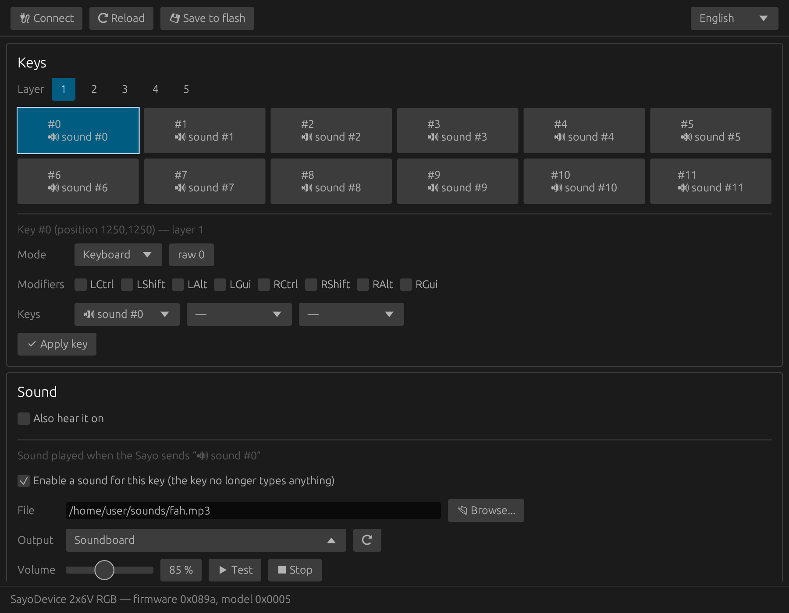
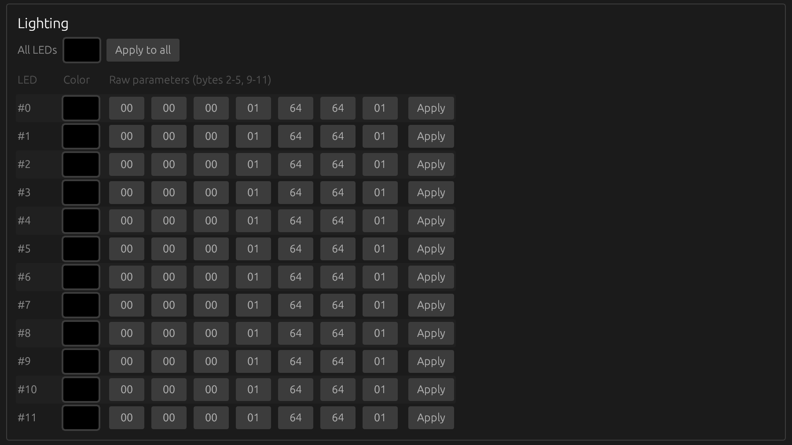

<div align="center">

# Sayoboard-K12

**A Linux configurator for the SayoDevice 2x6V keypad: keys, LEDs and a soundboard.**

[Français](README.md) | **English** | [日本語](README.ja.md)

[](LICENSE)

</div>



## What it does

- Remaps each key on each layer: up to three keys plus modifiers.
- Sets the color of one LED or all of them.
- Plays an audio file when a key is pressed, with its own volume and output device.
- Runs in English, French or Japanese.

Tested on a SayoDevice 2x6V RGB with firmware `0x089a`.

## Install

You need Rust 1.85 or later, PipeWire (`pw-play`), `pactl` and fontconfig. On Debian and Ubuntu, also install `libudev-dev` and `pkg-config`. Japanese text needs a Japanese font on the system.

```sh
cargo build --release
install -Dm755 target/release/sayo ~/.local/bin/sayo
sudo install -m644 70-sayo.rules /etc/udev/rules.d/
sudo udevadm control --reload && sudo udevadm trigger
```

The udev rule lets your user open the keypad without root.

To keep sounds working while the window is closed, enable the user service:

```sh
install -Dm644 sayo.service ~/.config/systemd/user/sayo.service
systemctl --user enable --now sayo
```

## Use

Run `sayo`. The window connects to the keypad when it opens.

To remap a key, pick a layer, click the key, choose its modifiers and keys, then click "Apply key". The change is live at once. "Save to flash" makes it survive unplugging.

To give a key a sound, select it and tick "Enable a sound for this key". Choose a file with "Browse..." or drop it on the window, then set the output and the volume. "Test" plays it. Sound settings are saved as you edit them.

"Also hear it on" plays a second copy on another output. Use it when your sounds go to a virtual sink that feeds your microphone and you want them in your headphones too.



In the lighting section, pick a color and click "Apply". The hex fields edit the other bytes of the LED record as raw values.

The language follows your system locale. You can change it in the top right corner, and the choice is kept in `~/.config/sayo/lang`.

## How it works

The keypad exposes several HID interfaces. Sayoboard-K12 configures it through the vendor one (usage page `0xFF00`) with 64-byte reports: report ID `0x02`, a command byte, the payload length, the payload, then a checksum equal to the sum of all previous bytes. It uses four commands: `0x00` reads device info, `0x16` reads or writes a key, `0x10` reads or writes an LED, and `0x04` saves to flash.

A key with a sound is reprogrammed to send HID code `0xC0` plus its key number, a code that types nothing. A listener thread reads the keypad's keyboard interface. When one of those codes appears, it starts `pw-play` with the file, volume and output you chose.

Sounds are stored in `~/.config/sayo/sons.tsv`, and the listener reloads the file when it changes. `sayo --fond` runs the listener without the window, which is what the systemd service does. A lock file stops the window and the service from playing the same sound twice.

## License

[CC BY-NC-SA 4.0](LICENSE), (c) 2026 AnnoyedDev.

You can use, modify and share this code under three conditions: credit AnnoyedDev with a link to the original project (https://github.com/AnnoyedDev/Sayoboard-K12), do not use it commercially, and publish your version under the same license.

Sayoboard-K12 is not affiliated with SayoDevice.
