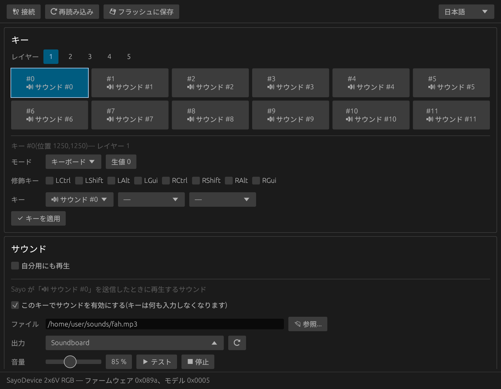
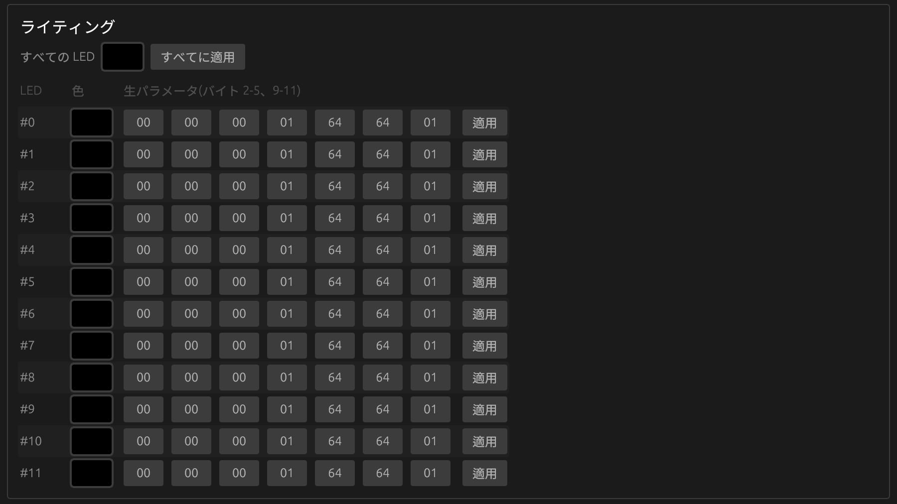

<div align="center">

# Sayoboard-K12

**SayoDevice 2x6V キーパッド用の Linux 向け設定ツール。キー、LED、サウンドボードをまとめて設定できます。**

[Français](README.md) | [English](README.en.md) | **日本語**

[](LICENSE)

</div>



## できること

- 各レイヤーの各キーに、最大 3 つのキーと修飾キーを割り当てる。
- LED の色を 1 個ずつ、またはまとめて設定する。
- キーを押したときに音声ファイルを再生する。音量と出力先はキーごとに選べます。
- 表示言語は日本語、英語、フランス語から選べます。

SayoDevice 2x6V RGB(ファームウェア `0x089a`)で動作を確認しています。

## インストール

Rust 1.85 以降、PipeWire(`pw-play`)、`pactl`、fontconfig が必要です。Debian と Ubuntu では `libudev-dev` と `pkg-config` も入れてください。日本語の表示には、システムに日本語フォントが必要です。

```sh
cargo build --release
install -Dm755 target/release/sayo ~/.local/bin/sayo
sudo install -m644 70-sayo.rules /etc/udev/rules.d/
sudo udevadm control --reload && sudo udevadm trigger
```

この udev ルールを入れると、root でなくてもキーパッドを開けます。

ウィンドウを閉じていてもサウンドを鳴らしたい場合は、ユーザーサービスを有効にします。

```sh
install -Dm644 sayo.service ~/.config/systemd/user/sayo.service
systemctl --user enable --now sayo
```

## 使い方

`sayo` を実行します。ウィンドウを開くとキーパッドに接続します。

キーを割り当て直すには、レイヤーを選んでキーをクリックし、修飾キーとキーを設定してから「キーを適用」を押します。変更はすぐに反映されます。「フラッシュに保存」を押すと、抜き差ししても設定が残ります。

キーにサウンドを付けるには、キーを選んで「このキーでサウンドを有効にする」にチェックを入れます。「参照...」でファイルを選ぶか、ウィンドウにドロップして、出力と音量を設定します。「テスト」で再生できます。サウンドの設定は変更するたびに保存されます。

「自分用にも再生」は、同じ音を別の出力にも流します。マイクにつないだ仮想出力へサウンドを送りつつ、自分のヘッドホンでも聞きたいときに使います。



ライティングでは、色を選んで「適用」を押します。16 進数の欄は、LED レコードの残りのバイトを生の値のまま編集します。

表示言語はシステムのロケールに従います。右上で変更でき、選んだ言語は `~/.config/sayo/lang` に保存されます。

## 仕組み

キーパッドは複数の HID インターフェースを持っています。Sayoboard-K12 はベンダー用インターフェース(usage page `0xFF00`)に 64 バイトのレポートを送って設定します。レポートはレポート ID `0x02`、コマンド 1 バイト、ペイロード長、ペイロード、チェックサムの順で、チェックサムはそれまでの全バイトの合計です。使うコマンドは 4 つです。`0x00` はデバイス情報の取得、`0x16` はキーの読み書き、`0x10` は LED の読み書き、`0x04` はフラッシュへの保存です。

サウンドを付けたキーは、HID コード `0xC0` にキー番号を足した値を送るように書き換えられます。このコードは何も入力しません。待ち受けスレッドがキーパッドのキーボード用インターフェースを読み、このコードが来ると、選んだファイル、音量、出力で `pw-play` を起動します。

サウンドの設定は `~/.config/sayo/sons.tsv` に保存され、ファイルが変わると待ち受け側が読み込み直します。`sayo --fond` はウィンドウなしで待ち受けだけを動かします。systemd サービスはこれを実行しています。ロックファイルがあるので、ウィンドウとサービスが同じ音を二重に鳴らすことはありません。

## ライセンス

[CC BY-NC-SA 4.0](LICENSE)、(c) 2026 AnnoyedDev。

次の 3 つの条件を守れば、このコードを自由に利用、改変、共有できます。AnnoyedDev のクレジットを元のプロジェクト(https://github.com/AnnoyedDev/Sayoboard-K12)へのリンク付きで表示すること、商用利用しないこと、改変版を同じライセンスで公開すること。

Sayoboard-K12 は SayoDevice とは無関係です。
