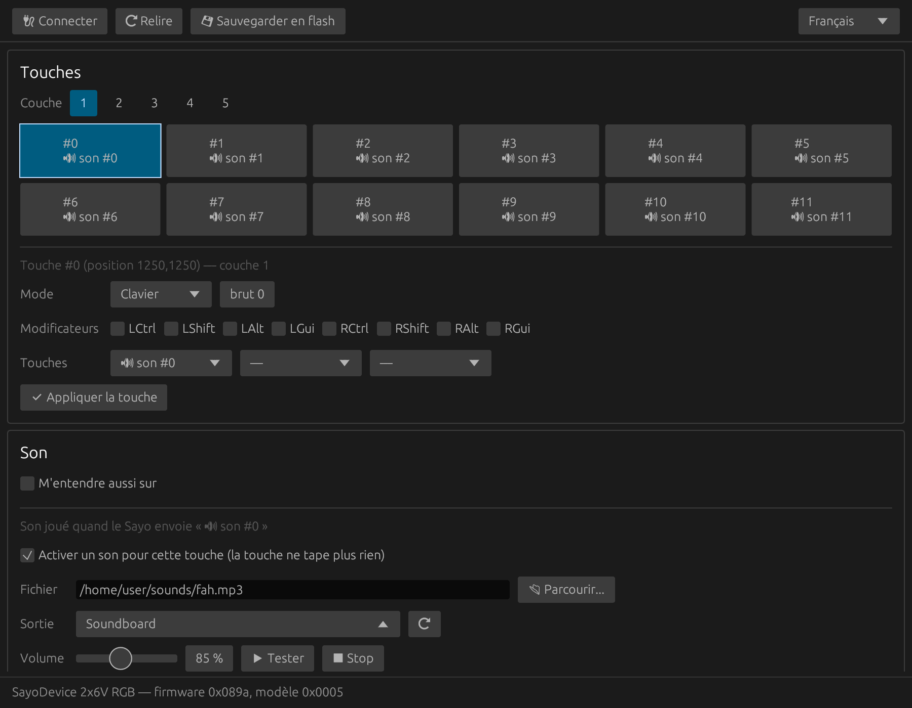
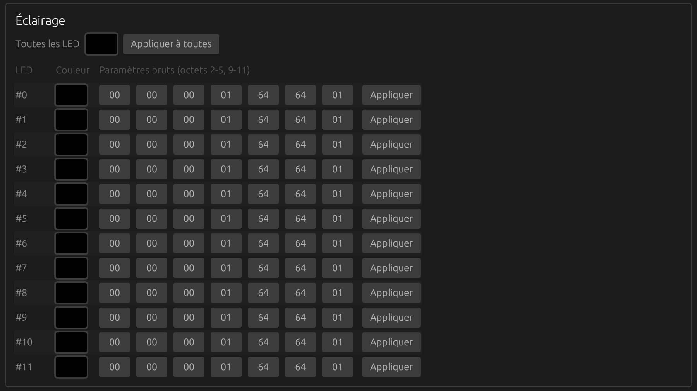

<div align="center">

# Sayoboard-K12

**Un configurateur Linux pour le pavé SayoDevice 2x6V : touches, LED et soundboard.**

**Français** | [English](README.en.md) | [日本語](README.ja.md)

[](LICENSE)

</div>



## Ce qu'il fait

- Réassigne chaque touche sur chaque couche : jusqu'à trois touches plus des modificateurs.
- Règle la couleur d'une LED ou de toutes.
- Joue un fichier audio à l'appui d'une touche, avec son propre volume et sa propre sortie.
- S'affiche en français, en anglais ou en japonais.

Testé sur un SayoDevice 2x6V RGB avec le firmware `0x089a`.

## Installation

Il faut Rust 1.85 ou plus récent, PipeWire (`pw-play`), `pactl` et fontconfig. Sous Debian et Ubuntu, installez aussi `libudev-dev` et `pkg-config`. Le japonais demande une police japonaise sur le système.

```sh
cargo build --release
install -Dm755 target/release/sayo ~/.local/bin/sayo
sudo install -m644 70-sayo.rules /etc/udev/rules.d/
sudo udevadm control --reload && sudo udevadm trigger
```

La règle udev permet à votre utilisateur d'ouvrir le pavé sans être root.

Pour que les sons fonctionnent fenêtre fermée, activez le service utilisateur :

```sh
install -Dm644 sayo.service ~/.config/systemd/user/sayo.service
systemctl --user enable --now sayo
```

## Utilisation

Lancez `sayo`. La fenêtre se connecte au pavé à l'ouverture.

Pour réassigner une touche, choisissez une couche, cliquez sur la touche, réglez ses modificateurs et ses touches, puis cliquez sur "Appliquer la touche". Le changement est actif tout de suite. "Sauvegarder en flash" le conserve après débranchement.

Pour donner un son à une touche, sélectionnez-la et cochez "Activer un son pour cette touche". Choisissez un fichier avec "Parcourir..." ou déposez-le sur la fenêtre, puis réglez la sortie et le volume. "Tester" le joue. Les réglages de son sont enregistrés à mesure que vous les modifiez.

"M'entendre aussi sur" joue une seconde copie sur une autre sortie. C'est utile quand vos sons partent vers une sortie virtuelle reliée à votre micro et que vous voulez aussi les entendre au casque.



Dans la section éclairage, choisissez une couleur et cliquez sur "Appliquer". Les champs hexadécimaux modifient les autres octets de l'enregistrement de la LED, en valeurs brutes.

La langue suit la locale du système. Vous pouvez la changer en haut à droite, et le choix est gardé dans `~/.config/sayo/lang`.

## Fonctionnement

Le pavé expose plusieurs interfaces HID. Sayoboard-K12 le configure par l'interface constructeur (page d'usage `0xFF00`) avec des rapports de 64 octets : l'identifiant de rapport `0x02`, un octet de commande, la longueur des données, les données, puis une somme de contrôle égale à la somme de tous les octets précédents. Quatre commandes sont utilisées : `0x00` lit les informations du périphérique, `0x16` lit ou écrit une touche, `0x10` lit ou écrit une LED, et `0x04` sauvegarde en flash.

Une touche dotée d'un son est reprogrammée pour envoyer le code HID `0xC0` plus son numéro, un code qui ne tape rien. Un thread d'écoute lit l'interface clavier du pavé. Quand un de ces codes apparaît, il lance `pw-play` avec le fichier, le volume et la sortie choisis.

Les sons sont stockés dans `~/.config/sayo/sons.tsv`, et l'écoute recharge le fichier quand il change. `sayo --fond` lance l'écoute sans la fenêtre, et c'est ce que fait le service systemd. Un fichier de verrou empêche la fenêtre et le service de jouer le même son deux fois.

## Licence

[CC BY-NC-SA 4.0](LICENSE), (c) 2026 AnnoyedDev.

Vous pouvez utiliser, modifier et partager ce code à trois conditions : créditer AnnoyedDev avec un lien vers le projet original (https://github.com/AnnoyedDev/Sayoboard-K12), ne pas en faire d'usage commercial, et publier votre version sous la même licence.

Sayoboard-K12 n'est pas affilié à SayoDevice.
